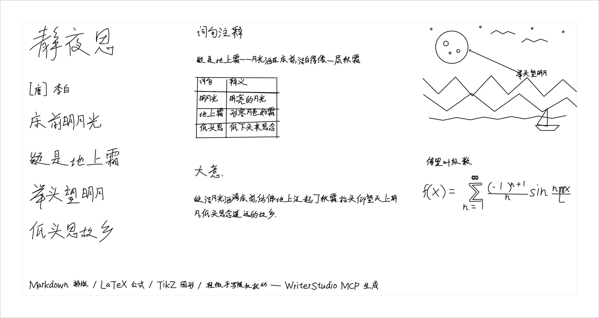

[简体中文](README.md) | **English**

A GRBL pen plotter host application. Text, tables, LaTeX formulas, TikZ and SVG vector graphics, stroke editing and handwriting simulation in one tool: mix multiple fonts, tune random handwriting perturbation, and align work to paper with reference layers.



## Download

Get the file for your platform from [Releases](https://github.com/ZhengXieGang/WriterStudio/releases):

| Platform | File | Usage |
|----------|------|-------|
| Windows | `WriterStudio.exe` | Double-click to run; no installation |
| Windows | `WriterStudioMCP.exe` | MCP bridge for AI layout; does not need to run, referenced by the AI app's MCP config, see [below](#ai-layout-mcp) |
| macOS | `WriterStudio-macos.zip` | Unzip and drag WriterStudio.app to Applications |
| Linux | `WriterStudio-x86_64.AppImage` | `chmod +x` then run |

Optional TeX toolchain (`xelatex` + `pdftocairo`).

## Features

### Content
* **Multi-font layout**: assign any font to any character in a document, with an automatic fallback chain (e.g. Chinese Kai + Latin single-stroke font)
* **Random handwriting perturbation**: size/position/line-start offset/baseline drift/stroke-level jitter, three presets plus full parameter control, deterministic (same seed reproduces; reshuffle the whole page)
* **Markdown**: headings/lists/tables; table rules are hand-drawn with random jitter, and cell text follows rule undulation
* **LaTeX**: formulas rendered by the built-in mathtext engine (no TeX needed); full LaTeX documents fall back to a built-in layout engine for common constructs (headings/sections/lists/formulas/simple tables) when TeX is missing, and upgrade to faithful PDF→SVG compilation when a TeX toolchain is detected; TikZ graphics require TeX
* **Vector drawing and SVG import**: rectangles/ellipses/lines; SVG import with hand-drawn jitter
* **Writing direction**: horizontal and vertical
* **Per-character font overrides**: assign a font/scale to selected characters

### Editing and layout
* Stroke editing tools: move/transform/bend/re-perturb/delete individual strokes
* Paper presets and **reference layers**: import images/SVGs as alignment underlays
* **Export**: G-code (for the plotter), PNG (custom resolution, 300 DPI default), SVG (vector, 1 unit = 1 mm)

## Supported font formats

| Type | Extension | Notes |
|------|-----------|-------|
| Hershey single-stroke | `.jhf` | 32 built-in Latin/symbol fonts |
| Single-stroke JSON | `STRK-*.json` | Built-in Chinese Kai (20,976 glyphs) |
| TrueType/OpenType | `.ttf` `.otf` | Outlines converted to single strokes via fontTools |
| G-code glyph library | one file per glyph | Directory of per-character G-code |
| `.gfont` | `.gfont` | Single-stroke font package |

## AI layout (MCP)

Let AI agents (Claude Desktop, Cline and other MCP clients) lay out whole pages directly in WriterStudio: handwritten text, data tables, coordinate diagrams, formulas — ready to send to the plotter. Every change remains undoable in the app.

**How it works**: WriterStudio embeds a local-only service (127.0.0.1:8765), and the MCP client connects through a bridge process. The bridge is a headless translator and requires a running WriterStudio. It ships with the app:

| Platform | Bridge location | MCP config |
|----------|-----------------|------------|
| Windows | Download `WriterStudioMCP.exe` separately from Releases and keep it in a fixed folder | `"command": "C:\\Tools\\WriterStudioMCP.exe"` |
| Linux AppImage | Bundled, no extra download | `"command": "/path/to/WriterStudio-x86_64.AppImage"`, add `"--mcp"` before `args` |
| macOS | Inside the app bundle: `/Applications/WriterStudio.app/Contents/MacOS/WriterStudioMCP` | Put that full path in `"command"` |
| From source | `pip install '.[ai]'` provides the `writerstudio-mcp` command | or `"python -m writerstudio.ai.bridge"` |

Windows example (the port is shown in AI Layout → AI Service Settings…, default 8765):

```json
{
  "mcpServers": {
    "writerstudio": {
      "command": "C:\\Tools\\WriterStudioMCP.exe",
      "args": ["--port", "8765"]
    }
  }
}
```

For the Linux AppImage, `args` is `["--mcp", "--port", "8765"]`. Once configured, agents have 24 tools:

* **Query**: page/fonts (filter by name or type)/objects/reference layers;
* **Content**: text, Markdown (tables/multiple paragraphs), TikZ graphics, math formulas — all support `anchor` (`top-left`/`center`/`bottom-left`/`baseline-left` etc.) to place directly on ruled lines; `measure_text` measures without modifying the document;
* **Underlay alignment**: four tools manage reference layers (not part of output); `render_preview(include_references=true)` draws underlays with transparency into the preview to check form alignment;
* **Checks and output**: `check_layout` (out of page/margins/overlap, with intersecting rectangles), `check_tex` (TeX/TikZ environment check), `render_preview`, `export_gcode`, open/save project.

**If it cannot connect**: the bridge diagnoses and reports readable errors — "nothing is listening" (app closed or service disabled), "port used by another program" (connects but does not answer, reported within 3 s), and automatically tries the port from the app settings when the configured one fails. AI Layout → AI Service Settings… shows service status and the actual port.

## License

This software: GPL-3.0-or-later, see [LICENSE](LICENSE).

Third-party data in bundled fonts:

* `fonts/builtin/hershey/*.jhf` — Hershey Fonts. Originally created by Dr. A. V. Hershey (U.S. National Bureau of Standards); data format by James Hurt (Cognition, Inc.). Free to use, including commercially, provided the acknowledgement is kept with the data; see [`fonts/builtin/hershey/ACKNOWLEDGEMENT.txt`](writerstudio/fonts/builtin/hershey/ACKNOWLEDGEMENT.txt).
* `fonts/builtin/stroke-json/STRK-Kaiti.json` — Chinese single-stroke font generated from a TTF by [chinese-hershey-font](https://github.com/LingDong-/chinese-hershey-font) (MIT, Copyright (c) 2018 Lingdong Huang).

<details>
<summary><b>Run from source</b></summary>

```bash
pip install -r requirements.txt   # or pip install .
python -m writerstudio            # start the UI
python -m pytest -q               # run tests (no display needed)
```

</details>

<details>
<summary><b>Build</b></summary>

PyInstaller cannot cross-compile; build natively on each platform:

```bash
pip install pyinstaller
pyinstaller writerstudio.spec    # single-file portable exe on Windows; directory build on Linux/macOS
python scripts/make_appimage.py  # Linux: assemble the directory build into an AppImage (zero-install distribution)
```

</details>

<details>
<summary><b>Project layout</b></summary>

```
├── writerstudio/
│   ├── core/       data layer (pure Python, no Qt)
│   ├── fonts/      font system (5 format parsers + layout engine + perturbation pipeline)
│   ├── perturb/    handwriting perturbation engine
│   ├── content/    Markdown / LaTeX / TikZ / SVG import
│   ├── machine/    G-code generation / GRBL protocol / serial link / path optimization
│   ├── ai/         AI layout (MCP service + stdio bridge)
│   └── ui/         PySide6 UI layer
├── tests/          unit tests (`python -m pytest -q`, offscreen)
├── tools/          helper scripts
└── scripts/        AppImage packaging, AI layout demo scripts
```

All tests run offscreen (`QT_QPA_PLATFORM=offscreen`), so they work on headless machines/CI.

</details>
